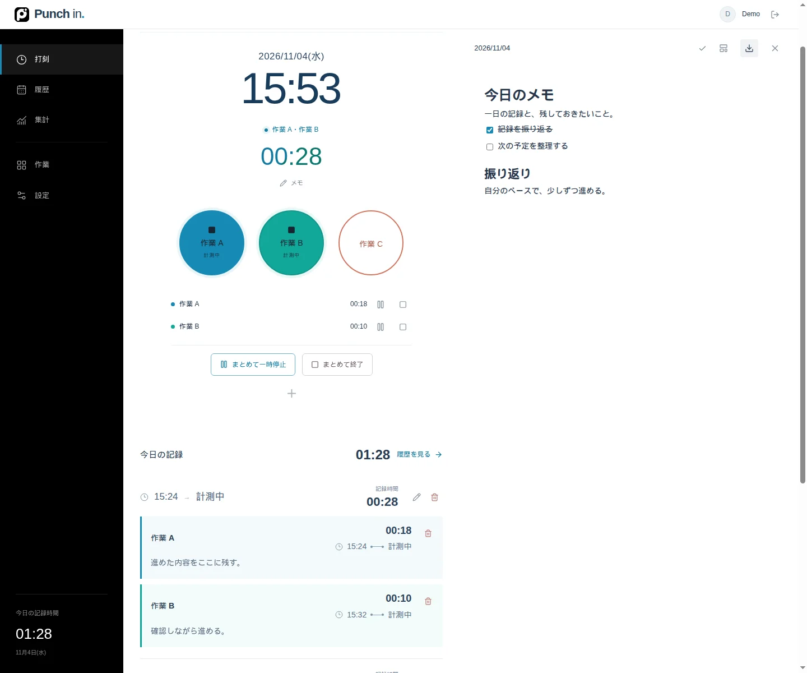
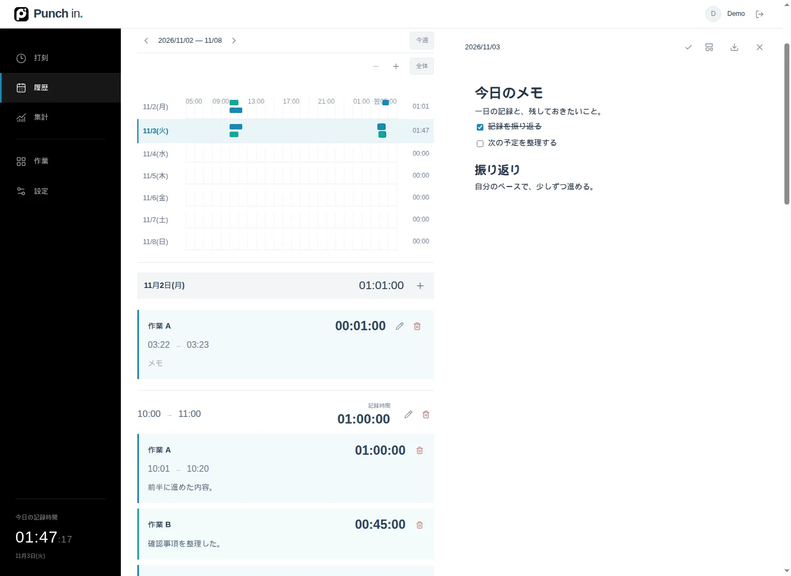
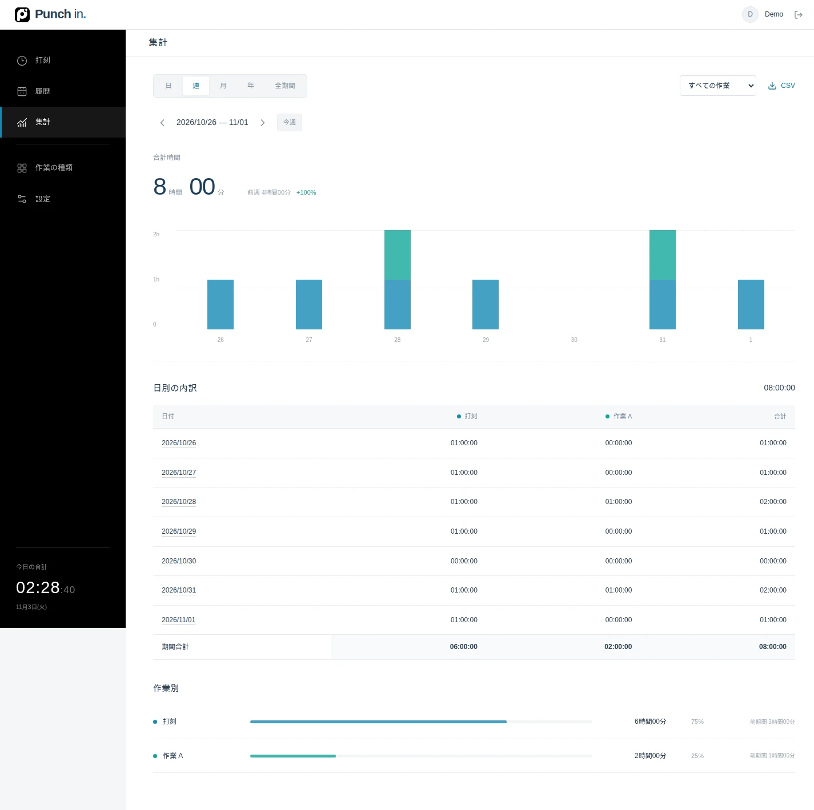

# Punch in

**ChatGPT Sitesを使って作成した、個人向けの時間記録アプリです。**

ボタンを押して、時間を記録する。自分に合う名前や色、1日の区切りを設定し、記録とメモをまとめて振り返れます。

## 画面

### 打刻と日別メモ

時計の下に打刻ボタン、右側に日別メモ。見出し・リスト・コード・表を、表示された見た目のまま編集できます。メモは自動保存されます。

履歴を見る

日付とタイムラインを上部に固定し、下へスクロールして過去の記録を確認。日付の行を押すと、その日のメモが開きます。メモ欄に直接入力でき、行末から記録の編集・削除ができます。

集計を見る

日・週・月・年・全期間を切り替え、種類別の内訳をグラフと表で確認できます。棒にカーソルを合わせると内訳が表示され、クリックすると該当する履歴に移動します。

画面は実際のアプリをローカルで起動し、表示用のサンプルデータで撮影しています。初期状態のボタンは「打刻」1つです。

## 主な機能

- **ひと押しで記録** — 開始・終了・種類の切り替え。同時計測は1種類。
- **自分に合う設定** — ボタンの追加・編集・非表示・並び替え、ボタンとテーマの色、1日の開始時刻、タイムゾーン。
- **記録とメモ** — 履歴検索、手動での追加・修正、記録ごとのメモ、日別ブロックメモの自動保存とMarkdown出力。
- **振り返り** — 期間別・種類別の合計、タイムライン、グラフ、秒単位の集計表、前期間との比較。
- **データを引き継ぐ** — 構造を保持するJSONバックアップ・復元、日別メモのMarkdown出力、履歴と集計のCSV出力。再実装時の移行仕様も公開。
- **画面幅に対応** — 狭い画面ではサイドバーを格納し、丸い打刻ボタンを維持。メモは下に並びます。

日の区切りをまたいだ記録は、開始した記録日にまとめて計上します。終了忘れ通知は、アプリを開いている間に利用できます。

## メモの操作

- ブロック左の六点ボタンから、本文・見出し・リスト・コード・引用への変更や表の挿入。
- リストでは`Tab`で1段インデント、`Shift + Tab`で1段戻す。`Enter`で次の項目へ。
- `/`で挿入メニュー。`# `で見出し、`- `で箇条書き。
- Windows/Linuxは`Ctrl + Shift + 数字`、Macは`Cmd + Option + 数字`で変換。

| 数字 | 種類 |
| --- | --- |
| `0` | 本文 |
| `1`〜`3` | 見出し1〜3 |
| `4` | チェックリスト |
| `5` | 箇条書き |
| `6` | 番号付きリスト |
| `7` | 折りたたみ |
| `8` | コード |

履歴をスクロールしても、開いているメモの日付は変わりません。既存のMarkdownメモは、初めて編集した際に原文を残して移行します。

## 技術構成

| 領域 | 使用技術 |
| --- | --- |
| 作成・ホスティング | ChatGPT Sites |
| フロントエンド | React / TypeScript / Vinext |
| 実行環境・データベース | Cloudflare Workers / D1 |
| 認証 | Sign in with ChatGPT |
| メモエディター | BlockNote / ProseMirror |

現在の[Sites版](https://punch-in-personal.linenhatch1.chatgpt.site)は所有者限定です。GitHubのソース公開とアプリの閲覧範囲は別に管理しています。

## 開発・引き継ぎ

Node.js 22.13.0以上を使用します。ローカルDBの準備、起動、検証、Sitesへの反映は[開発ガイド](docs/DEVELOPMENT.md)を参照してください。

| ドキュメント | 内容 |
| --- | --- |
| [開発ガイド](docs/DEVELOPMENT.md) | 環境構築・起動・テスト・ソース構成・公開手順 |
| [仕様](docs/SPEC.md) | 打刻、記録日、メモ、集計、画面の振る舞い |
| [APIとデータ移行](docs/API.md) | API、JSON形式、データの引き継ぎ |
| [再実装・運用の引き継ぎ](docs/HANDOVER.md) | 設計判断と別の構成へ移行するときの注意点 |
| [パフォーマンス](docs/PERFORMANCE.md) | 打刻処理の設計と測定結果 |
| [検証記録](docs/VALIDATION.md) | 実施したテストと確認範囲 |
| [公開前の確認](docs/SECURITY-REVIEW.md) | 秘密情報の確認範囲と結果 |
