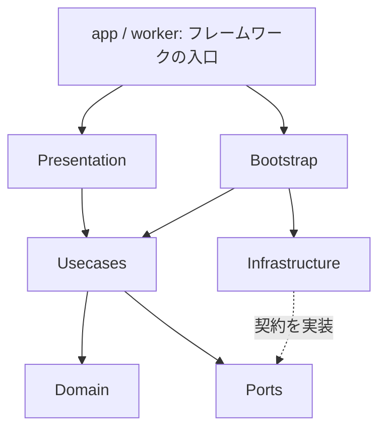

# アーキテクチャ

Punch inは、TypeScriptの単一アプリケーションとして構築する。Domain・Usecases・PortsをReact、Sites、Cloudflare D1の実装から分離し、業務ルールと外部システムの接続を別々に変更できる構成にする。

## 依存関係

矢印はコードの参照方向を示す。実行時にはUsecaseからPortに渡されたD1実装が呼ばれる。DomainとApplicationはInfrastructure・Presentation・Bootstrapを参照しない。HTTPのRequest・ResponseやD1の行データは境界で変換する。

ブラウザはHTTPクライアントを通してAPIを呼ぶ。サーバー用Usecase・認証・D1実装はブラウザへ組み込まない。型のみの契約と実行時の依存を区別し、動的importを含めて`npm run check:architecture`で検証する。

## ディレクトリ

| 場所 | 責務 |
| --- | --- |
| `app/` | Vinextのページ・APIルート。認証、HTTP入力、応答の入口 |
| `src/domain/` | 記録、作業、計測区間、配分、メモのデータとルール |
| `src/application/usecases/` | 打刻・編集・保存・移行の処理手順 |
| `src/application/ports/` | 保存先、時計、ID生成、クライアント通信の契約 |
| `src/application/contracts/` | リクエスト・応答・バックアップの型と形式 |
| `src/application/validation/` | 境界で受け取るデータの検証 |
| `src/infrastructure/` | D1・R2、Sites認証、HTTP、ブラウザ保存、時計・UUIDの実装 |
| `src/presentation/` | 機能別の画面・部品・Hookとブラウザ側の状態管理 |
| `src/bootstrap/` | 使用する実装の選択と依存の組み立て |
| `src/shared/` | 日時・時間の整形、色など、機能に依存しない処理 |
| `db/schema.ts`, `drizzle/` | DB構造と追記式のマイグレーション |
| `tests/` | 単体テスト、D1互換のSQL検証、ローカルWorkerのAPI検証 |
| `src/presentation/vendor/` | 導入済みUI部品。アプリ固有の画面とは分離する |

## 用語

| 名前 | 意味 |
| --- | --- |
| `WorkCategory` | ボタンに対応する作業カテゴリ |
| `TrackingSession` | 開始した記録日へ所属する、記録全体のまとまり |
| `WorkEntry` | まとまりの中の個々の作業記録。同じカテゴリの再打刻も別ID |
| `TrackingInterval` | 実際に計測した区間と、その区間の参加作業 |
| 記録時間 | 一時停止を除き、重複を数えない実際の計測時間 |
| 作業時間 | 自動・比率・手動の配分後に各作業へ計上する時間 |

Domainの型名を整理しても、DB列・HTTPのプロパティ・JSONバックアップv1〜v4の形式は変更しない。`work.members`などの保存名も保持する。

## 打刻と保存

`punch-work-category.ts`は対象カテゴリの状態を読み、開始・並行追加・終了・再開を決める。`update-tracking-session.ts`は一時停止・配分・個別時刻などの操作を調整する。状態遷移と配分計算はDomainが担当し、ブラウザの即時仮表示も同じルールを使う。

`TrackingRepository`は、読み込みと保存の契約を定義する。保存はrevisionの比較・更新と記録の更新を一括確定し、競合時に部分的な書き込みを残さない。`D1TrackingRepository`は既存のバッチ構成を維持する。通常の打刻では全履歴の取得や保存後の全件再取得を追加しない。

記録・カテゴリ・設定・インポートの複数更新は`AppStateRepository.commit`へ渡す。D1の各更新をmutation tokenで保護し、記録編集時には未確認のメモ上書きも防止する。汎用CRUDの順次呼び出しへ分解しない。

## メモとテンプレート

日別メモと作業メモは独立した保存キューを持つ。送信中の追加入力、競合、通信結果不明の再試行、ユーザー別のブラウザ下書きを扱う。日別メモの更新は打刻のrevisionを進めない。

並行作業の構造変更と作業メモ保存が重なっても、SQLの一括更新内で安定した作業記録IDを照合し、最新メモを引き継ぐ。保存配列の先頭は互換メモの参照元となるため、表示順のために保存配列を並べ替えない。

テンプレートの初回適用は`initialize-daily-note.ts`が判断する。既存のメモ・消去済みのメモへ再挿入せず、初回作成が競合した場合はDBに作成されたメモを返す。テンプレート本体と初期選択は独立したversionで管理する。

## 画面と性能

`PunchInApp`は画面間の調整と部品の組み立てを担当する。画面の表示、履歴の絞り込み、集計の選択、メモパネル、レスポンシブなナビゲーション、通知、サーバー同期を分離する。

`useAppSynchronization`は確定データと即時仮表示を分け、更新順序・再試行・メモ保存の応答を調整する。時計はサーバーとの時刻差を補正し、stateの定期取得は15秒ごと。変更なしの304応答、差分応答、終了済み記録のWeakMapキャッシュを維持する。メモエディターは遅延読み込みし、入力は独立したStoreへ購読する。

CSSは`src/presentation/styles/`へ分割し、`app/globals.css`のimport順でカスケードを維持する。既存のクラスとメディア・コンテナ条件を保持し、完全に同一の重複指定のみ除去する。外部エディターのスタイルとテーマ変数もこの順序を前提とする。

## 命名と整形

- 型・クラス・React部品はPascalCase、関数・変数はcamelCase、ファイルはkebab-case。
- 取得・計算・整形・保存を`find`、`calculate`、`format`、`save`などで区別する。
- 真偽値は`is`・`has`・`can`などで意味を示す。単位が重要な数値は`Ms`などを名前に含める。
- Prettierで改行・インデント・引用符を統一する。処理の意味のまとまりには空行を設ける。
- コメントは判断理由、互換性、原子性など、コードだけでは読み取れない制約を記す。
- 新しい処理を`utils`や`Manager`へ集めず、対象と責務が分かる場所へ置く。

## 検証

`npm test`は`.test.ts`を自動検出し、登録漏れを防ぐ。UsecaseはPortのテスト実装と固定の時計・IDで検証できる。D1互換のSQLiteテストで一括保存・競合・最新メモ保持も検証する。

CIは整形、依存境界、型、単体テスト、ビルドを確認する。ブラウザ操作とローカルWorkerのAPI検証は別途行う。API検証には実際の個人データや本番URLを使わない。

## プロフィールと共通メモ

`src/application/usecases/profile/`がプロフィールの保存・画像置換を調整する。`ProfileRepository`はD1の`user_profiles`、`AvatarStorage`は非公開のR2へ接続する。0007はプロフィールの表を追加するだけで、既存の記録やメモを書き換えない。表示名・画像はログインしたユーザーIDで分離し、ChatGPT側のプロフィールを変更しない。現在のSites認証契約に画像は含まれないため、未設定時は名前の頭文字を表示する。

画像はブラウザで256px四方へ切り抜き、再エンコードしてから送る。サーバーではサイズとラスタ形式を検証する。R2保存後にD1をCASで確定し、失敗時は新しい画像、成功時は置き換え前の画像を片付ける。片付けだけの失敗は確定済みの保存を失敗扱いにしない。

日別メモの選択と開閉は画面の種類から独立する。共通ヘッダーの開閉とパネルの日付選択を使い、通常の画面移動では日付・Store・エディターを保持する。日付変更時には既存の保存キューで前の日付を確定する。グラフの詳細が開いている間、Escapeは詳細を閉じ、メモまで同時に閉じない。

集計は`chart-scale.ts`で時間と目盛りを合わせる。`detail-placement.ts`は選択した列と交差しない配置を選び、置き場がなければグラフ直下へ表示する。装飾目的の横の区切り線は余白・控えめな背景へ置き換え、グラフ・タイムラインの時間を読む線は維持する。
